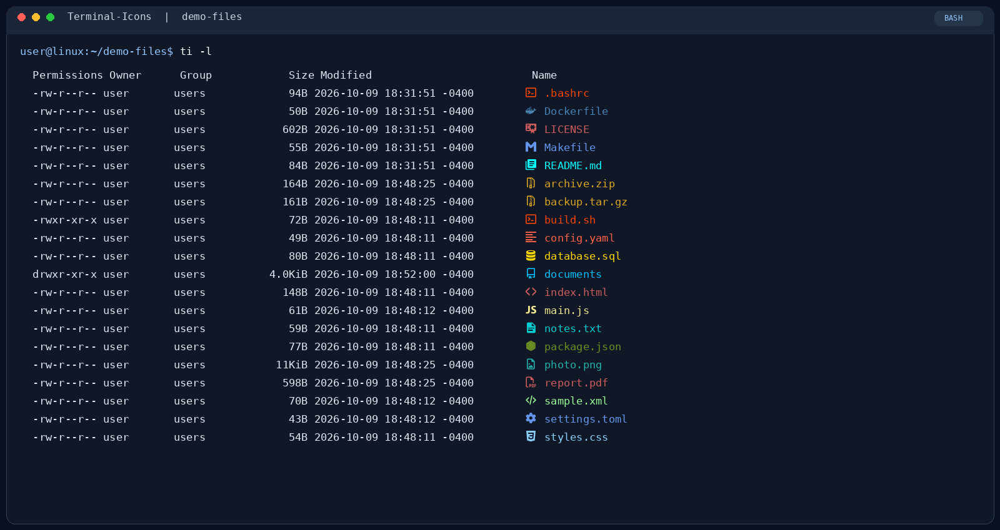
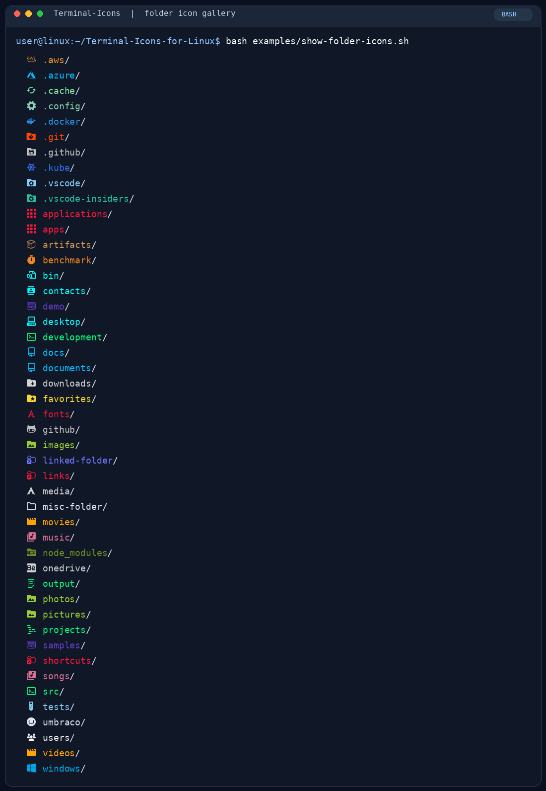

# Terminal-Icons for Linux

[](https://github.com/camilolsDev/Terminal-Icons-for-Linux/actions/workflows/ci.yml)
[](./LICENSE)
[](#requirements)

**Colorful Nerd Font icons for files and folders, right in your Bash terminal.**

Terminal-Icons is a Linux-friendly Bash counterpart to the
[devblackops/Terminal-Icons](https://github.com/devblackops/Terminal-Icons)
PowerShell module. Browse files with icons, inspect detailed metadata, or
navigate a directory tree with the simple `ti` command.

## Preview

`ti -l` displays permissions, owner, group, size, modified time, and an icon
matched to each file name or extension:



The theme also includes **45 named folder icons**, plus generic-folder and
directory-symlink icons:

<details>
<summary>View the complete folder icon gallery</summary>
<br>

</details>

The [demo files and screenshot guide](./examples/README.md) include the sample
files and both previews. Recreate the file listing locally with
`ti -l examples/demo-files`, or run `bash examples/show-folder-icons.sh` from
the repository root to see the folder icons in your terminal.

## Features

- File and folder icons powered by Nerd Fonts
- Detailed listings with permissions, owner, group, size, and modification time
- Recursive tree view, including hidden entries, without following symlinks
- True-color theme based on the upstream devblackops mappings
- Automatic color in interactive terminals; supports `NO_COLOR`, `--color`,
  and `--no-color`
- Bash completion for options and file paths
- Safe, repeatable installation and uninstall

## Requirements

- Bash 4.3 or newer
- GNU coreutils: `stat`, `date`, and `numfmt`
- A [Nerd Font](https://github.com/ryanoasis/nerd-fonts) and a terminal that
  supports it (for example, Kitty, Alacritty, foot, or GNOME Terminal with a
  Nerd Font configured)

## Install

### From a local checkout

```bash
git clone https://github.com/camilolsDev/Terminal-Icons-for-Linux.git
cd Terminal-Icons-for-Linux
bash install.sh
```

The installer copies the scripts, theme data, and license files into
`~/terminal-icons/`, then adds the loader to `~/.bashrc`. Re-run the installer
after updating the checkout to refresh the installed files. No `sudo` access
is needed.

To load it in the current terminal immediately:

```bash
source ~/terminal-icons/terminal-icons.sh
```

Interactive Bash shells read `~/.bashrc`. If your terminal starts a login
Bash that does not read it, add the `source` command above to the startup file
used by that terminal.

### Install a specific release

Choose a version from the project's
[GitHub Releases](https://github.com/camilolsDev/Terminal-Icons-for-Linux/releases)
and replace `vX.Y.Z` below with its tag:

```bash
git clone --depth 1 --branch vX.Y.Z \
  https://github.com/camilolsDev/Terminal-Icons-for-Linux.git
cd Terminal-Icons-for-Linux
bash install.sh
```

To update this checkout to a newer release:

```bash
git fetch --depth 1 origin tag vX.Y.Z
git checkout --detach vX.Y.Z
bash install.sh
```

To uninstall Terminal-Icons and remove its Bash startup entry, run from a
project checkout:

```bash
bash install.sh --uninstall
```

## Use `ti`

```bash
ti                         # List the current directory
ti /home/user/docs         # List a specific path
ti -l                      # Detailed listing
ti --bytes                 # Detailed listing with exact byte sizes
ti --tree                  # Recursive tree
ti --color                 # Force color
ti --no-color              # Disable color
```

Colors are automatic in interactive terminals and disabled when output is
piped. Set `NO_COLOR=1` to disable automatic colors. `--color` explicitly
forces color, while `--no-color` disables it for that invocation. Long
listings use human-readable binary units (such as `2.0KiB`); `--bytes` shows
exact byte counts.

### Optional `ls` and `ll` aliases

`ti` does not replace `ls` automatically. To add optional aliases, put these
lines in `~/.bashrc` after the Terminal-Icons loader:

```bash
alias ls='ti --color'
alias ll='ti --color -l'
```

Apply the change in the current terminal with `source ~/.bashrc`. These
aliases route commands to `ti` and do not preserve all GNU `ls` options.
Restore the normal `ls` command for the current terminal with
`unalias ls ll`.

## Development

Run the checks locally:

```bash
bash -n install.sh terminal-icons.sh icon-theme-data.sh color-theme-data.sh \
  tests/test_installer.sh tests/test_terminal_icons.sh
bash tests/test_terminal_icons.sh
bash tests/test_installer.sh
shellcheck -s bash install.sh terminal-icons.sh icon-theme-data.sh \
  color-theme-data.sh tests/*.sh
```

GitHub Actions runs the tests with Bash 4.3 and the runner's current Bash, and
checks the scripts with ShellCheck. Pushing a semantic-version tag such as
`v1.0.0` runs CI and publishes a GitHub Release with generated release notes.

## Credits and license

The icon and color mappings are adapted from the MIT-licensed
[devblackops/Terminal-Icons](https://github.com/devblackops/Terminal-Icons)
project and [Nerd Fonts](https://github.com/ryanoasis/nerd-fonts). See
[THIRD-PARTY-LICENSES.md](./THIRD-PARTY-LICENSES.md) for attributions. Linux
does not have Windows junctions, so the upstream junction-specific rules do
not apply.

Terminal-Icons for Linux is released under the [MIT License](./LICENSE).
